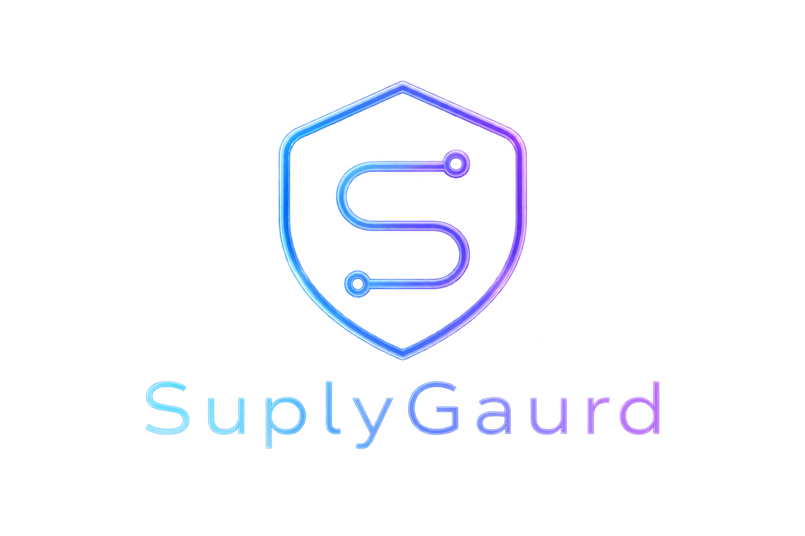
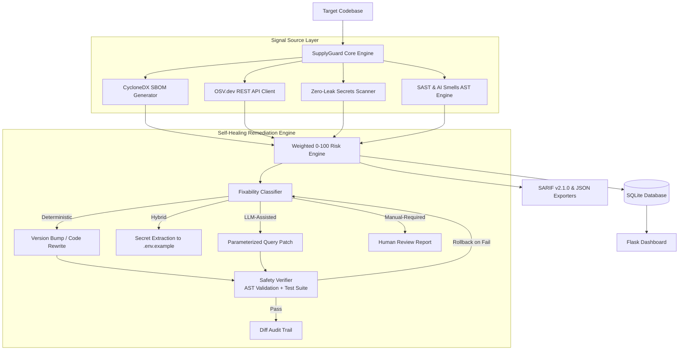

<div align="center">



# SupplyGuard

**Software Supply Chain Security Scanner & Self-Healing Remediation Engine**

[](https://pypi.org/project/supplyguard/)
[](https://www.python.org/downloads/)
[](LICENSE)
[](https://github.com/Taheraam/Supplyguard/actions/workflows/supplyguard-ci.yml)
[](https://docs.oasis-open.org/sarif/sarif/v2.1.0/sarif-v2.1.0.html)

<p align="center">
  Detect supply chain vulnerabilities, leaked credentials, and AI-generated code smells in seconds.<br>
  Compute an auditable 0–100 risk score, enforce CI/CD quality gates, and safely auto-patch fixable findings with test-backed rollbacks and SemVer-aware version selection.
</p>

[Quickstart](#quickstart) •
[Features](#features) •
[Installation](#installation) •
[CLI Reference](#cli-reference) •
[CI/CD Integration](#cicd-integration) •
[Architecture](#architecture) •
[Security Principles](#security-principles)

</div>

---

## Overview

Modern software development relies heavily on third-party dependencies and AI code generation. However, automated coding workflows regularly introduce critical vulnerabilities:
- Unpinned or vulnerable dependencies with published CVEs
- Leaked API keys, database credentials, and access tokens committed to version control
- Antipatterns common in AI-generated code: unparameterized SQL queries, dynamic subprocess execution with `shell=True`, disabled TLS certificate verification, and unverified JWT decoding

SupplyGuard addresses this by scanning codebases across four synchronized security dimensions, unifying findings into a weighted 0–100 risk score, exporting compliant SARIF reports for GitHub Code Scanning, and providing an automated remediation loop with built-in SemVer-aware version resolution, AST verification, and rollback safety.

---

## Features

- **CycloneDX SBOM Generation**: Builds a CycloneDX SBOM from `requirements.txt` (save it with `--sbom-output`). Only exact `==` pins are checked against OSV, since a range like `>=3.0` doesn't say which version is installed.
- **OSV.dev Vulnerability Correlation**: Real-time batch queries against the Open Source Vulnerability database. If OSV can't be reached, the scan exits `2` instead of reporting a clean result.
- **Secrets Scanner**: Gitleaks over the working tree **and git history** (deleted secrets are still leaked), with a built-in regex fallback. Matches are redacted before storage or display (`first 3 + ... + last 3`; secrets shorter than 12 chars are fully masked).
- **AI-Code Smell SAST**: 10 Semgrep rules (bundled) for weaknesses common in LLM-assisted code (CWE-89, CWE-78, CWE-295, CWE-489, CWE-347, CWE-916, CWE-330, CWE-862, CWE-94, CWE-942), with a built-in Python AST engine as a fallback when Semgrep is missing or fails.
- **SemVer-Aware Remediation**: Intelligent dependency resolution selecting the minimum compatible version (patch > minor > major) while preventing breaking major version jumps.
- **Self-Healing AST & Test Verification**: Every patch runs behind an in-memory backup → AST parse → targeted rescan (target finding gone, **no new findings**) → `pip install --dry-run` (wheels only, index options stripped) → project test suite, and is rolled back if any step fails.
- **Native SARIF v2.1.0 & CI Gates**: Native export to SARIF for the GitHub Security tab and configurable risk threshold exit codes (`--threshold 40`).
- **Zero-Config Execution**: Built-in fallback engines that operate out-of-the-box without requiring external binary installations.

---

## Installation

### 1. Global Installation (For Users)

For the easiest experience, install SupplyGuard globally using a single command from PyPI. This works across all operating systems.

**Windows, Mac & Linux:**
```bash
pip install supplyguard
```

*(Note: If you prefer isolated global CLI installations and have `pipx` installed, you can use `pipx install supplyguard` instead).*

### 2. Docker (Containerized)

If you prefer using Docker, you can build and run the image directly:

```bash
docker build -t supplyguard .
docker run --rm -v $(pwd):/src supplyguard scan /src
```

### 3. From Source (For Developers)

If you plan to modify the code, clone the repository and install it in editable mode. The activation step depends on your operating system.

**Mac & Linux:**
```bash
git clone https://github.com/Taheraam/Supplyguard.git
cd Supplyguard
python3 -m venv .venv
source .venv/bin/activate
pip install -e ".[dev]"
```

**Windows (PowerShell):**
```powershell
git clone https://github.com/Taheraam/Supplyguard.git
cd Supplyguard
python -m venv .venv
.\.venv\Scripts\Activate.ps1
pip install -e ".[dev]"
```

---

## Quickstart

### 1. Initialize Configuration
Generate a `.supplyguard.yml` policy file for your project:
```bash
supplyguard init
```

### 2. Run a Read-Only Security Scan
```bash
supplyguard scan .
```

### 3. CI/CD Security Gate (Fail if Risk > 40)
```bash
supplyguard scan . --threshold 40 --format sarif -o results.sarif
```
*Exits with code `0` on pass, or code `1` if the risk score exceeds the threshold.*

### 4. Preview Automated Remediation (Dry Run)
```bash
supplyguard fix . --dry-run
```

### 5. Apply Remediation Patches
```bash
supplyguard fix . --max-iterations 3
```

### 6. Launch the Local Web Dashboard
```bash
supplyguard web --port 5000
```
*Navigate to `http://127.0.0.1:5000` to review scan history and patch diffs.*

---

## CLI Reference

### `supplyguard scan [PATH]`

Scan a target codebase for dependencies, vulnerabilities, secrets, and static code smells.

| Option | Short | Default | Description |
|---|---|---|---|
| `--format` | `-f` | `table` | Output format: `table`, `json`, or `sarif`. |
| `--threshold` | `-t` | `100` | Risk score threshold (0–100). Exits with code `1` if exceeded. |
| `--output` | `-o` | `stdout` | Write output to a specific file path. |
| `--db-path` | | `supplyguard.db` | Target SQLite database path for history tracking. |
| `--sbom-output` | | *(not saved)* | Save the CycloneDX SBOM to this path. Nothing is written into the scanned project. |
| `--verbose` | `-v` | `false` | Enable verbose debug output. |

#### Exit Codes:
- `0`: Scan passed (Risk Score <= Threshold)
- `1`: Policy violation (Risk Score > Threshold)
- `2`: Tool error (including OSV.dev unreachable). CI should treat this as a failure, not a pass.

---

### `supplyguard fix [PATH]`

Execute the self-healing remediation loop.

> **Trust boundary:** `scan` never executes code from the scanned project. `fix` does: it runs the
> project's test suite and pip resolution to verify each patch. Only run `fix` on code you trust.

| Option | Default | Description |
|---|---|---|
| `--dry-run` | `false` | Simulate patches without modifying files on disk. |
| `--max-iterations` | `5` | Maximum number of fix-and-rescan convergence iterations. |
| `--no-llm` | `false` | Disable LLM-assisted patches and use only deterministic rules. |
| `--db-path` | `supplyguard.db` | SQLite database path. |

---

### `supplyguard report <SCAN_ID>`

Retrieve and format results from a previous scan stored in SQLite:
```bash
supplyguard report 1 --format json
```

---

## Configuration (`.supplyguard.yml`)

Project-level settings can be configured via a `.supplyguard.yml` file placed at the root of the target repository:

```yaml
# .supplyguard.yml

# Risk score threshold for CI builds (0-100)
threshold: 40

# Default output format: table | json | sarif
format: table

# Minimum severity level to include in scan results (CRITICAL, HIGH, MEDIUM, LOW)
severity_minimum: MEDIUM

# Paths to exclude from scanning
ignore_paths:
  - ".venv/"
  - "tests/"
  - "docs/"
  - "node_modules/"

# Rule IDs or CWE identifiers to suppress
ignore_rules:
  - "CWE-489"  # Allow debug=True in local development
```

---

## CI/CD Integration

### GitHub Actions

Upload scan findings directly to the **GitHub Security -> Code Scanning** tab:

```yaml
name: SupplyGuard Security Gate

on:
  push:
    branches: [ "main" ]
  pull_request:
    branches: [ "main" ]

jobs:
  security-scan:
    runs-on: ubuntu-latest
    permissions:
      security-events: write
    steps:
      - name: Checkout Code
        uses: actions/checkout@v4

      - name: Set up Python
        uses: actions/setup-python@v5
        with:
          python-version: "3.11"

      - name: Install SupplyGuard
        run: pip install supplyguard

      - name: Run Security Scan
        id: scan
        run: |
          set +e
          supplyguard scan . --format sarif --threshold 40 -o results.sarif
          echo "exit_code=$?" >> "$GITHUB_OUTPUT"

      - name: Upload SARIF to GitHub Security
        uses: github/codeql-action/upload-sarif@v3
        if: always()
        with:
          sarif_file: results.sarif
          category: supplyguard

      # Upload first, then fail — so findings are visible even when the gate blocks the build.
      - name: Enforce gate
        if: steps.scan.outputs.exit_code != '0'
        run: exit 1
```

Install [Gitleaks](https://github.com/gitleaks/gitleaks) and `pip install semgrep` in the job to use the full
scanners instead of the built-in fallbacks. See [`.github/workflows/supplyguard-ci.yml`](.github/workflows/supplyguard-ci.yml)
for the pipeline this repo runs on itself (tests on 3.11–3.13, wheel-content check, checksum-verified Gitleaks,
blocking self-scan). Releases are published from [`publish.yml`](.github/workflows/publish.yml) using PyPI
Trusted Publishing (OIDC), so no PyPI API token is stored in GitHub.

---

## Architecture



---

## Fixability Classification

SupplyGuard maintains a strict separation between safe automated fixes and changes requiring developer architectural review:

| Finding Category | CWE | Strategy | Action |
|---|---|---|---|
| In-Series Vulnerable Dependency (e.g. `0.3.13` ➔ `0.3.30`) | — | **Deterministic** | Selects minimum compatible version; verifies syntax & dry-run install before keeping. |
| Major Version / Breaking Dependency Jump (e.g. `0.x` ➔ `1.x`, `1.x` ➔ `2.x`) | — | **Manual-Required** | Flagged with explanation; prevents API breaking changes in downstream code. |
| Vulnerable Dependency (No Fix Available) | — | **Manual-Required** | Flags finding; no published fixed version exists. |
| Test Suite Files (`tests/test_*.py`) | — | **Manual-Required** | Protected from automated edits to avoid test harness disruption. |
| Hardcoded Secret | CWE-798 | **Hybrid** | Extracts stub to `.env.example`, redacts in place, flags key for rotation. |
| TLS Validation Disabled (`verify=False`) | CWE-295 | **Deterministic** | Restores TLS certificate validation. |
| Production Debug Mode (`debug=True`) | CWE-489 | **Deterministic** | Sets `debug=False`. |
| Unverified JWT Decode | CWE-347 | **Deterministic** | Enforces signature verification checks. |
| Insecure Randomness for Secrets | CWE-330 | **Deterministic** | Migrates `random` usage to `secrets` module. |
| SQL Injection (String Formatting) | CWE-89 | **LLM-Assisted** | Constructs parameterized query patch gated on AST and test suite verification. |
| Subprocess Shell Injection | CWE-78 | **LLM-Assisted** | Converts shell command strings to argument lists. |
| Unprotected Sensitive Route | CWE-862 | **Manual-Required** | Escalated to developer; cannot infer authentication model. |
| Dynamic Code Execution (`eval`/`exec`/`pickle`) | CWE-94 / 502 | **Manual-Required** | Escalated to developer; requires architectural refactoring. |
| CORS Wildcard with Credentials | CWE-942 | **Manual-Required** | Escalated to developer; requires explicit origin allowlist. |

---

## Security Principles

1. **Local-Only Remediation**: `supplyguard fix` never pushes or merges changes to remote branches. All modifications remain local for developer review.
2. **Zero Raw Secret Storage**: Secret matches are redacted before logging, database persistence, or display. Detected secrets are never "auto-fixed": `fix` adds an env-var stub and lists the secret under manual actions (remove from source and history, then rotate).
3. **Dry-Run & Rollback-on-Failure**: Automated patches must pass syntax parsing, package dry-run checks, and existing test suites before being kept. If verification fails, changes are reverted automatically.
4. **Fail Closed**: If OSV.dev is unreachable or Semgrep errors, SupplyGuard reports a tool error or falls back to its built-in engine. It never reports a clean result it didn't verify.
5. **No Intent Guessing**: Security-critical controls such as authentication boundaries, major version jumps, and authorization decorators are never guessed and are flagged for manual review.

---

## Limitations

- Python only; dependencies are read from `requirements.txt` (not `pyproject.toml`, Poetry or lockfiles yet).
- The risk score is capped at 100, so very large backlogs all read as 100. Use the JSON/SARIF output for counts.
- LLM-assisted patches need `ANTHROPIC_API_KEY`; without it a small rule-based fallback is used.

---

## Contributing

Contributions are welcome. Please ensure that all changes include appropriate test coverage and pass static checks:

```bash
# Run unit and integration tests
pytest tests/ -v

# Run linting
ruff check .
```

---

## License

This project is licensed under the [MIT License](LICENSE).
